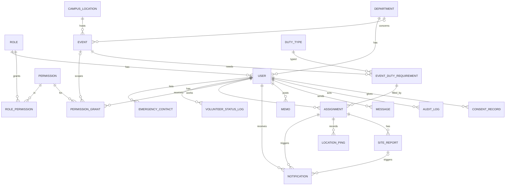

# Database

MySQL 8, InnoDB, utf8mb4. Times are stored in UTC and shown in Asia/Manila. All tables use `id` bigint unsigned auto increment unless noted.

## 1. Gaps found in the brief's data model

The 20 tables cover the flows, but several flows have nowhere to store their data. These are proposals, not silent changes. Nothing below adds a 21st domain table.

| # | Table | Gap | Proposed fix |
|---|---|---|---|
| G1 | ASSIGNMENT | No place for acknowledge time, duty start and end, cancel reason, or the reason for a headcount override | Add `acknowledged_at`, `duty_started_at`, `duty_ended_at`, `cancelled_at`, `cancel_reason`, `override_reason`, `updated_at` |
| G2 | USER | No password, login or account disable fields. `status` mixes "volunteer on call" with "account enabled" | Add `password`, `remember_token`, `email_verified_at`, `last_login_at`, `disabled_at`. Keep `status` (active, inactive) for on-call availability only |
| G3 | USER and ROLE | The brief asks for an enum-cast role but also a ROLE table with `role_id` | Keep `role_id` and the ROLE table (needed for ROLE_PERMISSION). Add a unique `code` column to ROLE (`admin`, `marshal`, `volunteer`, `coordinator`) and a PHP `Role` enum. `User::role()` returns the enum. |
| G4 | EVENT | Coordinators must see "event notices relevant to their department", but EVENT has no department link | Add nullable `department_id` (null means campus wide), plus `description` and `created_by` |
| G5 | EVENT_DUTY_REQUIREMENT | A requirement can need a specific team (for example Fire Suppression) | Add nullable `team_needed` |
| G6 | SITE_REPORT | No status, so "overdue" cannot be stored. Designation is stored in PERMISSION_GRANT (event scoped), which works | Add `status` (pending, submitted, overdue, late), `unique(assignment_id, due_at)` |
| G7 | NOTIFICATION | Only `assignment_id`, but report reminders, overdue alerts and welcome emails also exist. No recipient, no error or retry info | Add `user_id` (recipient), nullable `site_report_id`, `channel` (email), `scheduled_for`, `attempts`, `last_error`, `created_at`. Keep `assignment_id` nullable |
| G8 | LOCATION_PING | No accuracy or server time | Add `accuracy_m` (smallint), `received_at` |
| G9 | AUDIT_LOG | Cannot tell which record or what changed | Add `entity_id`, `meta` (JSON, before and after for changes), `ip_address` |
| G10 | CONSENT_RECORD | Location consent is separate from the privacy notice, and consent can be withdrawn | Add `purpose` (privacy_notice, location_tracking), `withdrawn_at`, `ip_address` |
| G11 | MESSAGE | No read status. Coordinators write to "DRRMO", not to one admin | Add `read_at`. `recipient_id` null means the DRRMO office inbox, which every admin can read and answer |
| G12 | MEMO | Admin can "write" a memo, but there is no body. No edit or delete tracking | Add `body` (text, nullable), make `file_path` nullable, add `updated_at`, `deleted_at` (soft delete) |
| G13 | VOLUNTEER_STATUS_LOG | Does not store who made the change | Add `changed_by` |
| G14 | PERMISSION_GRANT | Grants cannot be ended early | Add `revoked_at`, `revoked_by` |

## 2. Diagram



## 3. Migration order

Each module gets a fixed timestamp prefix so parallel sessions never collide and order is always correct. New migrations inside a module use the next free number in its range.

| Order | Prefix | Module | Tables |
|---|---|---|---|
| 0 | `0001_01_01_*` | Core | Laravel defaults: cache, jobs, failed_jobs, sessions, password_reset_tokens |
| 1 | `2026_01_01_1000xx` | Access | roles, permissions, role_permission, and `100004` adds `description` and `is_system` to roles (custom roles have `is_system` false) |
| 2 | `2026_01_01_2000xx` | Personnel | departments, users (FK roles, departments), emergency_contacts, volunteer_status_logs, and `200005` adds the sign up columns to users (account_status, email code fields, reviewed_by, reviewed_at, rejection_reason), and `200006` replaces `users.name` with `first_name` and `last_name` |
| 3 | `2026_01_01_3000xx` | Events | duty_types, campus_locations, events, event_duty_requirements, assignments |
| 4 | `2026_01_01_3500xx` | Access | refresh_tokens (needs users), permission_grants (needs events) |
| 5 | `2026_01_01_4000xx` | Monitoring | location_pings, site_reports |
| 6 | `2026_01_01_5000xx` | Notifications | notifications (needs assignments, site_reports) |
| 7 | `2026_01_01_6000xx` | Information | memos, messages |
| 8 | `2026_01_01_7000xx` | Records | audit_logs, consent_records |

Laravel's default `users` migration is replaced by the Personnel version. The default `sessions` table keeps its `user_id` column without a foreign key.

Foreign key rules: `restrict` on delete for people and events (we soft-close, not delete). `cascade` for child rows that mean nothing alone: emergency contacts, role_permission, location_pings and site_reports of a deleted assignment. Actor columns (`assigned_by`, `granted_by`, `posted_by`, `actor_id`, `changed_by`) use `nullOnDelete` so history survives.

## 4. Indexes

| Table | Index | Why |
|---|---|---|
| users | unique(email), (role_id, status), (department_id), (account_status, created_at) | login, assignable list, access requests list |
| permission_grants | (user_id, permission_id, ends_at), (event_id) | permission check runs on most requests |
| role_permission | unique(role_id, permission_id) | no duplicates |
| events | (starts_at), (status), (department_id) | dashboard, coordinator notices |
| event_duty_requirements | (event_id), (shift_start, shift_end) | overlap checks, scheduler |
| assignments | unique(user_id, requirement_id), (user_id, status), (requirement_id, status) | my assignments, headcount |
| location_pings | (assignment_id, captured_at), (captured_at) | latest ping per person, retention purge |
| site_reports | unique(assignment_id, due_at), (status, due_at) | idempotent slots, overdue scan, feed |
| notifications | (status, scheduled_for), (user_id, type), (assignment_id) | queue scan, dedupe |
| memos | FULLTEXT(title, body), (category, posted_at) | search |
| messages | (recipient_id, read_at), (sender_id, sent_at) | inbox, threads |
| audit_logs | (actor_id, created_at), (entity, entity_id), (action, created_at) | audit filters |
| consent_records | (user_id, purpose, consented_at) | consent check |

Overlap check for one person: two shifts overlap when `a.shift_start < b.shift_end AND b.shift_start < a.shift_end`, excluding cancelled assignments.

Latest ping per person for the map, which the `(assignment_id, captured_at)` index serves:

```sql
SELECT p.*
FROM location_pings p
JOIN (
  SELECT assignment_id, MAX(captured_at) AS last_at
  FROM location_pings
  WHERE assignment_id IN (/* on_duty assignments */)
  GROUP BY assignment_id
) x ON x.assignment_id = p.assignment_id AND x.last_at = p.captured_at;
```

## 5. Keeping LOCATION_PING healthy

- Worst case about 58,000 rows a day. Ten working days stays under 600,000 rows. MySQL handles this without partitioning.
- `monitoring:purge-pings` runs at 02:00, computes the cutoff as "10 working days ago" (counting back Monday to Friday), and deletes in chunks of 5,000 rows with a short pause between chunks so the table is never locked for long.
- No foreign key from location_pings to other modules except `assignment_id`, and no secondary indexes beyond the two above. Fewer indexes keep inserts cheap.
- Inserts arrive in batches of up to 50 rows per request, using one multi-row `INSERT`.
- If the table ever grows past a few million rows, monthly partitioning by `captured_at` is the next step. It is not needed at this size.

## 6. Seeders

| Seeder | Content | Runs in production |
|---|---|---|
| RoleSeeder | admin, marshal, volunteer, coordinator | yes |
| PermissionSeeder | every permission code in SECURITY_AND_PRIVACY.md and the role matrix | yes |
| DutyTypeSeeder | Emergency responder, Auxiliary to campus security, CCTV monitoring and surveillance, Enforcement of campus policies, Crowd control, Office work, Fire suppression | yes |
| CampusLocationSeeder | ZPPSU main campus center (6.91212, 122.05909) plus placeholder rows for the gym, main gate, field and admin building. Coordinates to be confirmed on the map by DRRMO. | yes |
| DepartmentSeeder | Placeholder list, to be replaced with the real department list | yes, after review |
| AdminUserSeeder | One admin from `.env` values (`SEED_ADMIN_EMAIL`), random password, set-password email | yes, once |
| DemoSeeder | Fake people (Faker, `example.test` emails), one sample event with requirements and assignments | local and staging only |

No real personal data goes into seeders, fixtures or tests.
