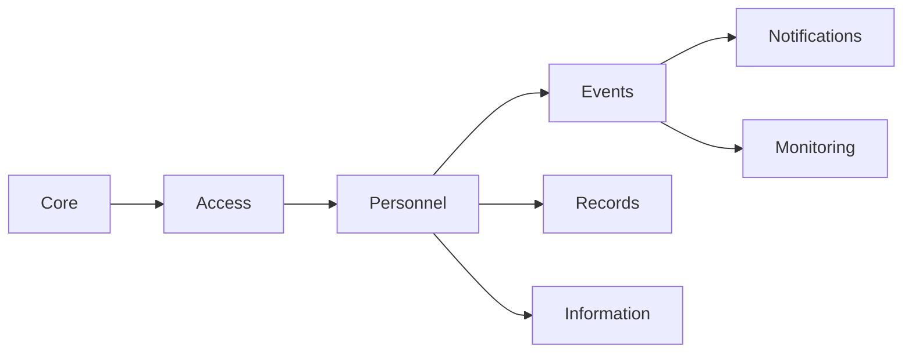

# Modules

The app is split into seven domain modules plus a thin Core. Each of the 20 domain tables is owned by exactly one module. Only the owning module writes to its tables. Other modules read through the owner's public service or listen to its events.

## Rules for everyone

1. **Own your tables.** A module never runs `insert`, `update` or `delete` on another module's table. Reading another module's Eloquent model in a query (for example a `with('user')`) is fine.
2. **Talk through contracts.** Cross-module calls go through a class in the owner's `Contracts/` folder or through a Laravel event. Contracts are agreed in a PR before anyone codes against them.
3. **Every endpoint has a policy or gate.** No exceptions.
4. **Sensitive actions call `AuditLogger`** (Records contract). The list is in SECURITY_AND_PRIVACY.md.
5. **Shared files belong to Core.** `routes/api.php`, `bootstrap/app.php`, `resources/js/app/router.tsx`, the layouts and the UI kit change only through a small PR labelled `core`.

## Backend layout (same for every module)

```
app/Modules/<Module>/
  Actions/            single-purpose classes, e.g. CreateAssignment
  Contracts/          interfaces other modules may use
  Enums/
  Events/             domain events this module fires
  Http/Controllers/
  Http/Requests/
  Http/Resources/
  Jobs/
  Listeners/          reactions to other modules' events
  Models/
  Policies/
  Console/            scheduled commands
  routes.php          this module's API routes, loaded by its provider
  <Module>ServiceProvider.php
tests/Feature/<Module>/
tests/Unit/<Module>/
```

## Frontend layout (same for every module)

```
resources/js/features/<module>/
  api.ts              typed calls to this module's endpoints
  hooks/              data hooks (TanStack Query)
  pages/admin/        desktop-first pages
  pages/mobile/       mobile-first pages
  components/
  routes.tsx          route objects exported to the Core router
```

## Summary

| Module | Owns tables | Depends on |
|---|---|---|
| Core | framework tables only (sessions, cache, jobs, failed_jobs, password_reset_tokens, migrations) | nothing |
| Personnel | DEPARTMENT, USER, EMERGENCY_CONTACT, VOLUNTEER_STATUS_LOG | Access (role lookup), Records |
| Access | ROLE, PERMISSION, ROLE_PERMISSION, PERMISSION_GRANT | Records |
| Events | DUTY_TYPE, CAMPUS_LOCATION, EVENT, EVENT_DUTY_REQUIREMENT, ASSIGNMENT | Personnel, Access, Records |
| Notifications | NOTIFICATION | Events, Monitoring (listens only), Records (listens only), Personnel |
| Monitoring | LOCATION_PING, SITE_REPORT | Events, Access, Records |
| Information | MEMO, MESSAGE | Personnel, Records |
| Records | AUDIT_LOG, CONSENT_RECORD | Personnel |

Count: 4 + 4 + 5 + 1 + 2 + 2 + 2 = 20 tables. Each appears once.

---

## Core

- **Owns:** app shell, Blade entry view, `bootstrap/app.php`, `routes/api.php` (which only includes module route files), auth endpoints, `/api/me`, the `EnsureConsented` middleware, layouts, UI kit, API client, PWA files, error handling.
- **Endpoints:** `POST /api/login`, `POST /api/refresh`, `POST /api/logout`, `POST /api/forgot-password`, `POST /api/reset-password`, `GET /api/me`. Auth is the JWT guard (`auth:api`, app/Auth).
- **Frontend:** `resources/js/app`, `resources/js/layouts`, `resources/js/shared`.
- **Must not touch:** any module's business rules.
- Note: `EnsureConsented` reads consent through the Records contract `ConsentChecker`.

## Personnel

- **Owns:** DEPARTMENT, USER, EMERGENCY_CONTACT, VOLUNTEER_STATUS_LOG.
- **Endpoints:**
  - `GET /api/people` (filters: role, team, status, department, search), `POST /api/people`, `GET /api/people/{user}`, `PATCH /api/people/{user}`, `POST /api/people/import` (CSV)
  - `PATCH /api/people/{user}/status` (volunteer active or inactive, reason required)
  - `GET /api/people/{user}/status-history`
  - `GET /api/me/profile`, `PATCH /api/me/profile` (contact number only)
  - `GET|POST|PATCH|DELETE /api/me/emergency-contacts[/{contact}]`
  - `GET /api/departments`, admin CRUD on `/api/departments`
  - `POST /api/register`, `POST /api/register/verify`, `POST /api/register/resend` (public Request access for volunteers)
  - `GET /api/admin/registrations`, `POST /api/admin/registrations/{user}/approve`, `POST /api/admin/registrations/{user}/reject`
- **Policies:** `UserPolicy`, `EmergencyContactPolicy`, `DepartmentPolicy`.
- **Contracts used:** `MailSender` (Notifications), `ConsentRecorder` and `AuditLogger` (Records).
- **Contracts offered:** `PersonDirectory` (find assignable people: active, right role and team).
- **Events fired:** `VolunteerStatusChanged`, `PersonCreated`.
- **Frontend:** `features/personnel` with admin pages People list, Person profile, Import, and mobile pages My profile, Emergency contacts.
- **Must not touch:** assignments, grants, consent rows.

## Access (RBAC)

- **Owns:** ROLE, PERMISSION, ROLE_PERMISSION, PERMISSION_GRANT.
- **Endpoints:**
  - `GET /api/permissions` (catalog with label, group, admin and grantable flags)
  - `GET /api/roles`, `POST /api/roles`, `GET /api/roles/{role}`, `PATCH /api/roles/{role}`, `DELETE /api/roles/{role}` (custom roles only, once empty)
  - `PUT /api/roles/permissions` (saves one or more roles at once, all or nothing, refuses locked cells)
  - `POST /api/roles/{role}/members` (moves people into the role through Personnel's `PersonRoleChanger`)
  - `GET /api/role-options` (role names for the People screens, with `can_assign` for the signed-in person; needs `people.view` or `people.manage`)
  - `GET /api/me/access` (the signed-in person's role and its permissions in plain words)
  - `GET /api/grants` (filters: user, event, active), `POST /api/grants`, `POST /api/grants/{grant}/revoke`
- **Policies:** `GrantPolicy`, `RolePolicy`.
- **Contracts offered:** `RoleGuard::canHandOut(User $actor, Role $role): bool`, the no escalation rule that Personnel calls before it creates, edits or imports a person. `PermissionChecker::allows(User $user, string $code, ?int $eventId = null): bool`. Rule: role has the permission, or there is an active grant (`starts_at <= now < ends_at`, not revoked) for that user and code, where the grant's event is null or matches `$eventId`. Results are cached per request.
- **Gate wiring:** a `Gate::before` style hook lets every policy call `$user->can('code', $event)` and get this rule.
- **Events fired:** `PermissionGranted`, `PermissionRevoked`.
- **Frontend:** `features/access` with the admin Access control group (Roles, Role detail, Permission matrix, Temporary access) and the phone My access page.
- **Must not touch:** users' role column (Personnel owns it and offers `PersonRoleChanger`), assignments.

## Events and Assignments

- **Owns:** DUTY_TYPE, CAMPUS_LOCATION, EVENT, EVENT_DUTY_REQUIREMENT, ASSIGNMENT.
- **Endpoints:**
  - `GET|POST /api/events`, `GET|PATCH|DELETE /api/events/{event}`
  - `GET|POST /api/events/{event}/requirements`, `PATCH|DELETE /api/requirements/{requirement}`
  - `GET /api/requirements/{requirement}/candidates` (assignable people with conflict flags)
  - `POST /api/requirements/{requirement}/assignments` (one or many user ids, optional `override_reason`)
  - `PATCH /api/assignments/{assignment}` (status changes by admin), `POST /api/assignments/{assignment}/cancel`
  - `GET /api/me/assignments?scope=today|upcoming|past`, `GET /api/me/assignments/{assignment}`
  - `POST /api/me/assignments/{assignment}/acknowledge`
  - `GET /api/me/event-notices` (coordinator: events for their department or campus wide)
  - `GET|POST|PATCH /api/duty-types`, `GET|POST|PATCH /api/campus-locations`
  - `GET /api/admin/dashboard` (today's events, unacknowledged, no-show risk)
- **Policies:** `EventPolicy`, `RequirementPolicy`, `AssignmentPolicy`.
- **Contracts offered:** `AssignmentLookup` (active assignment for a user, assignment state transitions `startDuty` and `endDuty` so Monitoring does not write ASSIGNMENT directly).
- **Events fired:** `AssignmentCreated`, `AssignmentUpdated`, `AssignmentCancelled`, `AssignmentAcknowledged`.
- **Frontend:** `features/events` with admin pages Event list, Event detail, Requirement and assignment editor, Dashboard, and mobile pages My assignments, Assignment detail.
- **Must not touch:** pings, reports, notifications rows.

## Notifications

- **Owns:** NOTIFICATION.
- **Endpoints:** `GET /api/notifications` (admin log, filters: type, status, date), `POST /api/notifications/{notification}/retry`.
- **Listens to:** `AssignmentCreated`, `AssignmentUpdated`, `AssignmentCancelled`, `ReportSlotCreated`, `ReportOverdue`, `PersonCreated` (welcome and set password email), `LocationConsentWithdrawn` (tells people with `location.view`).
- **Jobs and commands:** `SendNotificationJob`, `notifications:shift-reminders`.
- **Policies:** `NotificationPolicy`.
- **Contracts offered:** `Notifier::queue(User $to, NotificationType $type, array $context)`. Any module may call this instead of sending mail itself.
- **Frontend:** `features/notifications` with admin page Notification log.
- **Must not touch:** any other table. It reads assignments and users only to fill email templates.

## Monitoring (GPS and site reports)

- **Owns:** LOCATION_PING, SITE_REPORT.
- **Endpoints:**
  - `POST /api/me/assignments/{assignment}/start-duty`, `POST /api/me/assignments/{assignment}/end-duty` (calls `AssignmentLookup`)
  - `POST /api/me/assignments/{assignment}/pings` (batch, throttled)
  - `GET /api/map/latest?event_id=` (latest ping per on-duty person, writes audit entry)
  - `GET /api/map/trail/{assignment}` (pings for one assignment, writes audit entry)
  - `GET /api/me/report-slots`, `POST /api/me/report-slots/{report}` (summary, optional photo)
  - `GET /api/reports` (feed: event, location, date filters, newest first), `GET /api/reports/{report}`, `GET /api/reports/{report}/photo`
- **Jobs and commands:** `monitoring:create-report-slots`, `monitoring:mark-overdue-reports`, `monitoring:auto-end-duty`, `monitoring:purge-pings`.
- **Policies:** `LocationPolicy`, `SiteReportPolicy`.
- **Events fired:** `ReportSlotCreated`, `ReportSubmitted`, `ReportOverdue`.
- **Frontend:** `features/monitoring` with admin pages Live map, Report feed, and mobile components Duty banner, Ping engine (hook `useDutyTracker`), Report form.
- **Must not touch:** ASSIGNMENT directly. Status changes go through `AssignmentLookup`.

## Information (memos and messages)

- **Owns:** MEMO, MESSAGE.
- **Endpoints:**
  - `GET /api/memos?q=&category=`, `GET /api/memos/{memo}`, `GET /api/memos/{memo}/file`
  - `POST /api/memos`, `PATCH /api/memos/{memo}`, `DELETE /api/memos/{memo}` (admin)
  - `GET /api/messages/threads`, `GET /api/messages/threads/{user}`, `POST /api/messages`, `POST /api/messages/{message}/read`
- **Policies:** `MemoPolicy`, `MessagePolicy`.
- **Frontend:** `features/information` with admin page Memo manager and DRRMO inbox, mobile pages Memo search, Memo viewer, Messages.
- **Must not touch:** anything outside its two tables.

## Records (audit and consent)

- **Owns:** AUDIT_LOG, CONSENT_RECORD.
- **Endpoints:**
  - `GET /api/audit-logs` (filters: actor, action, entity, date)
  - `GET /api/privacy-notice` (current version and text), `POST /api/consents`, `POST /api/consents/withdraw-location`
  - `GET /api/me/data-export` (the person's own data as JSON, right of access)
- **Events fired:** `LocationConsentWithdrawn`.
- **Contracts offered:** `AuditLogger::log(string $action, Model|string $entity, ?int $entityId, array $meta = [])`, `ConsentChecker::has(User $user, ConsentPurpose $purpose)`.
- **Jobs and commands:** `records:prune`.
- **Policies:** `AuditLogPolicy`.
- **Frontend:** `features/records` with admin page Audit log, mobile pages Consent and Privacy notice.
- **Must not touch:** other modules' tables. Audit rows are insert only. There is no update or delete endpoint.

## Build order and parallel work



Records' two contracts (`AuditLogger`, `ConsentChecker`) are stubbed in M0 so every module can call them from day one. After the walking skeleton, Notifications, Monitoring and Information can be built in parallel because they only consume contracts from Events and Personnel.
