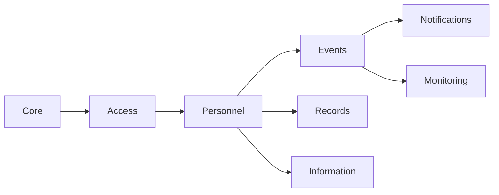

# Modules

The app is split into seven domain modules plus a thin Core. Each of the 27 domain tables is owned by exactly one module. Only the owning module writes to its tables. Other modules read through the owner's public service or listen to its events.

## Rules for everyone

1. **Own your tables.** A module never runs `insert`, `update` or `delete` on another module's table. Reading another module's Eloquent model in a query (for example a `with('user')`) is fine.
2. **Talk through contracts.** Cross-module calls go through a class in the owner's `Contracts/` folder or through a Laravel event. Contracts are agreed in a PR before anyone codes against them.
3. **Every endpoint has a policy or gate.** No exceptions.
4. **Sensitive actions call `AuditLogger`** (Records contract). The list is in SECURITY_AND_PRIVACY.md.
5. **Shared files belong to Core.** `routes/api.php`, `bootstrap/app.php`, `resources/js/app/router.tsx`, the layouts and the UI kit change only through a small PR labelled `core`.

## Backend layout (same for every module)

```
app/Modules/<Module>/
  Actions/            single-purpose classes, e.g. CreateAssignment
  Contracts/          interfaces other modules may use
  Enums/
  Events/             domain events this module fires
  Http/Controllers/
  Http/Requests/
  Http/Resources/
  Jobs/
  Listeners/          reactions to other modules' events
  Models/
  Policies/
  Console/            scheduled commands
  routes.php          this module's API routes, loaded by its provider
  <Module>ServiceProvider.php
tests/Feature/<Module>/
tests/Unit/<Module>/
```

## Frontend layout (same for every module)

```
resources/js/features/<module>/
  api.ts              typed calls to this module's endpoints
  hooks/              data hooks (TanStack Query)
  pages/admin/        desktop-first pages
  pages/mobile/       mobile-first pages
  components/
  routes.tsx          route objects exported to the Core router
```

## Summary

| Module | Owns tables | Depends on |
|---|---|---|
| Core | framework tables only (sessions, cache, jobs, failed_jobs, password_reset_tokens, migrations) | nothing |
| Personnel | DEPARTMENT, TEAM, USER, EMERGENCY_CONTACT, VOLUNTEER_STATUS_LOG | Access (role lookup), Records |
| Access | ROLE, PERMISSION, ROLE_PERMISSION, PERMISSION_GRANT, REFRESH_TOKEN | Records |
| Events | DUTY_TYPE, CAMPUS_LOCATION, EVENT_TYPE, EVENT, EVENT_DUTY_REQUIREMENT, ASSIGNMENT | Personnel, Access, Records |
| Notifications | NOTIFICATION, PUSH_SUBSCRIPTION, ALERT_PREFERENCE | Events, Monitoring (listens only), Records (listens only), Personnel |
| Monitoring | LOCATION_PING, SITE_REPORT, EMERGENCY_REPORT, REPORT_REVIEWER | Events, Access, Records |
| Information | MEMO, MESSAGE | Personnel, Records |
| Records | AUDIT_LOG, CONSENT_RECORD | Personnel |

Count: 5 + 5 + 6 + 3 + 4 + 2 + 2 = 27 tables. Each appears once. Each module also has a README in `app/Modules/<Module>/` and in `resources/js/features/<module>/`.

---

## Core

- **Owns:** app shell, Blade entry view, `bootstrap/app.php`, `routes/api.php` (which only includes module route files), auth endpoints, `/api/me`, the `EnsureConsented` middleware, the service worker (`public/sw.js`) and web manifest, layouts, UI kit, API client, PWA files, error handling.
- **Endpoints:** `POST /api/login`, `POST /api/refresh`, `POST /api/logout`, `POST /api/forgot-password`, `POST /api/reset-password`, `GET /api/me`. Auth is the JWT guard (`auth:api`, app/Auth).
- **Frontend:** `resources/js/app`, `resources/js/layouts`, `resources/js/shared`.
- **Shared record codes:** `app/Support` holds `HasPublicCode`, `PublicCode` and `PublicCodeColumn`. In the endpoint lists below, a name in braces such as `{event}` or `{id}` is the record's public code, never its number (see DATABASE.md).
- **Must not touch:** any module's business rules.
- Note: `EnsureConsented` reads consent through the Records contract `ConsentChecker`.

## Personnel

- **Owns:** DEPARTMENT, TEAM, USER, EMERGENCY_CONTACT, VOLUNTEER_STATUS_LOG.
- **Endpoints:**
  - `GET /api/people` (filters: role, team, status, department, search), `POST /api/people`, `GET /api/people/{user}`, `PATCH /api/people/{user}`, `POST /api/people/{user}/invite` (sends the set password email)
  - `GET /api/people/import/template`, `POST /api/people/import` (CSV)
  - `GET /api/admin/volunteers`, `PUT /api/admin/volunteers/{user}/status` (volunteer active or inactive, reason required), `GET /api/admin/volunteers/{user}/status-history`
  - `GET /api/me/availability` (the person's own on-call status)
  - `GET /api/me/profile`, `PATCH /api/me/profile` (contact number only)
  - `GET|POST|PUT|DELETE /api/me/emergency-contacts[/{contact}]`, `GET /api/admin/people/{user}/emergency-contacts`
  - `GET|POST|PATCH|DELETE /api/departments[/{department}]` and `/api/teams[/{team}]` (the Manage lists screen, which also edits event types, duty types and campus locations through the Events endpoints)
  - `POST /api/register`, `POST /api/register/verify`, `POST /api/register/resend` (public Request access for volunteers)
  - `GET /api/admin/registrations`, `POST /api/admin/registrations/{user}/approve`, `POST /api/admin/registrations/{user}/reject`
- **Policies:** `UserPolicy`. Departments, teams and emergency contacts use its gate abilities (`viewPeople`, `managePeople`, `manageOwnProfile`).
- **Contracts used:** `MailSender` (Notifications), `ConsentRecorder` and `AuditLogger` (Records).
- **Contracts offered:** `PersonRoleChanger` (moves a person to another role, used by Access).
- **Frontend:** `features/personnel` with admin pages People list, Person profile, Import, Manage lists, Access requests, and mobile pages My profile, Emergency contacts, Availability.
- **Must not touch:** assignments, grants, consent rows.

## Access (RBAC)

- **Owns:** ROLE, PERMISSION, ROLE_PERMISSION, PERMISSION_GRANT, REFRESH_TOKEN (written by the login code through `app/Auth/RefreshTokens.php`).
- **Endpoints:**
  - `GET /api/permissions` (catalog with label, group, admin and grantable flags)
  - `GET /api/roles`, `POST /api/roles`, `GET /api/roles/{role}`, `PATCH /api/roles/{role}`, `DELETE /api/roles/{role}` (custom roles only, once empty)
  - `PUT /api/roles/permissions` (saves one or more roles at once, all or nothing, refuses locked cells)
  - `POST /api/roles/{role}/members` (moves people into the role through Personnel's `PersonRoleChanger`)
  - `GET /api/role-options` (role names for the People screens, with `can_assign` for the signed-in person; needs `people.view` or `people.manage`)
  - `GET /api/me/access` (the signed-in person's role and its permissions in plain words)
  - `GET /api/grantable-permissions`, `GET /api/grants` (filters: user, event, active), `POST /api/grants`, `POST /api/grants/{grant}/revoke`, `GET /api/me/grants`
- **Policies:** `GrantPolicy`, `RolePolicy`.
- **Contracts offered:** `RoleGuard::canHandOut(User $actor, Role $role): bool`, the no escalation rule that Personnel calls before it creates, edits or imports a person. `PermissionChecker::allows(User $user, string $code, ?int $eventId = null): bool`. Rule: role has the permission, or there is an active grant (`starts_at <= now < ends_at`, not revoked) for that user and code, where the grant's event is null or matches `$eventId`. Results are cached per request.
- **Gate wiring:** a `Gate::before` style hook lets every policy call `$user->can('code', $event)` and get this rule.
- **Events fired:** `PermissionGranted`, `PermissionRevoked`.
- **Frontend:** `features/access` with the admin Access control group (Roles, Role detail, Permission matrix, Temporary access, Report reviewers) and the phone My access page.
- **Must not touch:** users' role column (Personnel owns it and offers `PersonRoleChanger`), assignments.

## Events and Assignments

- **Owns:** DUTY_TYPE, CAMPUS_LOCATION, EVENT_TYPE, EVENT, EVENT_DUTY_REQUIREMENT, ASSIGNMENT.
- **Endpoints:**
  - `GET|POST /api/events`, `GET /api/events/calendar`, `GET|PUT /api/events/{event}`, `POST /api/events/{event}/publish`, `POST /api/events/{event}/cancel`
  - `POST /api/events/{event}/requirements`, `DELETE /api/requirements/{requirement}`
  - `GET /api/requirements/{requirement}/candidates` (assignable people with conflict flags)
  - `POST /api/requirements/{requirement}/assignments` (one or many user ids, optional `override_reason`)
  - `PATCH /api/assignments/{assignment}`, `DELETE /api/assignments/{assignment}`, `POST /api/assignments/{assignment}/cancel`, `POST /api/assignments/{assignment}/no-show`
  - `GET /api/me/assignments?scope=today|upcoming|past`, `POST /api/me/assignments/{assignment}/acknowledge`
  - `GET /api/me/event-notices` (coordinator: events for their department or campus wide)
  - `GET /api/event-lookups`, `GET|POST|PATCH|DELETE /api/event-types`, `GET|POST|PATCH|DELETE /api/campus-locations` (duty types are read through `event-lookups`)
  - `GET /api/dashboard` (today's events, unacknowledged, no-show risk)
- **Policies:** `EventPolicy`. Requirements and assignments use its gate abilities (`create`, `assign`, and so on).
- **Contracts offered:** `AssignmentLookup` (active assignment for a user, assignment state transitions `startDuty` and `endDuty` so Monitoring does not write ASSIGNMENT directly).
- **Calls out through:** `AssignmentNotifier` (Notifications contract), so Events never sends mail itself.
- **Jobs and commands:** `assignments:mark-no-shows` and `events:complete-ended`, both every 5 minutes.
- **Frontend:** `features/events` with admin pages Event list with calendar, Event detail, Requirement and assignment editor, Dashboard, and mobile pages My assignments, Assignment detail.
- **Must not touch:** pings, reports, notifications rows.

## Notifications

- **Owns:** NOTIFICATION, PUSH_SUBSCRIPTION, ALERT_PREFERENCE.
- **Endpoints:** `GET /api/me/notifications`, `GET /api/me/alerts`, `POST /api/me/alerts/read` (in app alerts), `GET /api/notifications` (admin log, filters: type, status, date), `POST /api/notifications/{notification}/retry`.
  - Push and alert settings: `GET /api/me/push` (devices and settings), `PUT /api/me/alert-settings` (mute sound or push, quiet hours), `POST|DELETE /api/push/subscribe`, `DELETE /api/push/devices/{subscription}`, `POST /api/push/test` (throttled).
- **Listens to:** `ReportSlotCreated`, `ReportOverdue`, `ReportMissed`, `EmergencyReported`, `EmergencyReminder`, `EmergencyEscalated` (in app alert, push and email for the reviewer marshals and admins), `LocationConsentWithdrawn` (tells people with `location.view`). Assignment mail goes through the `AssignmentNotifier` contract, called by Events.
- **Jobs and commands:** `SendNotificationEmail` and `SendPush` jobs (urgent pushes use the `high` queue), `notifications:send-reminders` (shift reminders, every 5 minutes), `notifications:send-report-reminders` (reporter, 15 minutes before a report is due and at the due time), `notifications:prune` (log older than 6 months, 02:15), `push:vapid` (one time, makes the VAPID keys).
- **Policies:** `NotificationPolicy`, `PushSubscriptionPolicy`.
- **Contracts offered:** `AssignmentNotifier` (used by Events), `MailSender` (PHPMailer in production, log driver locally) and `PushTransport` (Web Push). Any module that needs an alert goes through `AlertSender` or `Pusher`, never straight to the push service.
- **Frontend:** `features/notifications` with admin page Notification log, and the Alerts settings and My notifications pages for everyone. The service worker is `public/sw.js`.
- **Must not touch:** any other table. It reads assignments and users only to fill email templates and to find who gets an alert.

## Monitoring (GPS and site reports)

- **Owns:** LOCATION_PING, SITE_REPORT, EMERGENCY_REPORT, REPORT_REVIEWER (added by the site report rework).
- **Endpoints:**
  - `POST /api/me/assignments/{assignment}/start-duty`, `POST /api/me/assignments/{assignment}/end-duty` (calls `AssignmentLookup`)
  - `POST /api/me/assignments/{assignment}/pings` (batch, throttled)
  - `GET /api/map/latest?event_id=` (latest ping per on-duty person, writes audit entry)
  - `GET /api/map/trail/{assignment}` (pings for one assignment, writes audit entry)
  - `GET /api/me/report-slots`, `POST /api/me/report-slots/{report}` (summary, optional photo), `GET /api/me/report-slots/{report}/photo`
  - `GET /api/reports` (feed: event, location, date filters, newest first), `GET /api/reports/{report}`, `GET /api/reports/{report}/photo`
  - Emergencies: `POST /api/me/assignments/{assignment}/emergencies` (type, note, photo, `client_id`; place comes from the latest ping), `GET /api/me/emergencies`, `GET /api/me/emergencies/{emergency}/photo`, `GET /api/emergencies` (reviewers), `GET /api/emergencies/{emergency}` (adds the place, audited), `GET /api/emergencies/{emergency}/photo`, `POST /api/emergencies/{emergency}/acknowledge`, `POST /api/emergencies/{emergency}/resolve`
  - `GET /api/me/report-slots/{report}/emergencies` (emergencies of the event since the previous report, for the report form), `GET /api/attention` (open emergencies, overdue and missed reports, per event counts; audited)
  - Reviewers (admin, `access.manage`): `GET /api/report-reviewers`, `PUT /api/report-reviewers` (up to 2 active marshals, the same for every event; they hold `reports.view` for every event and get the alerts)
- **Jobs and commands:** `monitoring:mark-missed-reports` (an empty slot closes as `missed` 60 minutes after it was due), `monitoring:remind-emergencies` (reviewers, once, 2 minutes unacknowledged), `monitoring:escalate-emergencies` (every minute, escalates after 5 minutes unacknowledged), `monitoring:create-report-slots`, `monitoring:mark-overdue-reports`, `monitoring:auto-end-duty`, `monitoring:purge-pings` (02:00, pings older than 10 working days), `monitoring:prune-photos` (02:45, report photos older than 1 year). Slot creation, overdue marking and auto end duty run every minute or every 5 minutes (see `MonitoringServiceProvider`).
- **Policies:** `SiteReportPolicy`, `EmergencyReportPolicy`. Map and trail checks use the `location.view` permission.
- **Events fired:** `ReportSlotCreated`, `ReportOverdue`, `EmergencyReported`, `EmergencyReminder`, `EmergencyEscalated`, `ReportMissed`.
- **Frontend:** `features/monitoring` with admin pages Live map, Reports (Needs attention, Emergencies and All reports tabs) and Report reviewers, and mobile pages My reports, Report form, Emergency inbox, plus the components Duty banner, Ping engine (hook `useDutyTracker`), Report form.
- **Must not touch:** ASSIGNMENT directly. Status changes go through `AssignmentLookup`.

## Information (memos and messages)

- **Owns:** MEMO, MESSAGE.
- **Endpoints:**
  - `GET /api/memos?q=&category=`, `GET /api/memos/{memo}`, `GET /api/memos/{memo}/file`, `GET /api/memos/{memo}/preview` (PDF copy of a Word file)
  - `POST /api/memos`, `PATCH /api/memos/{memo}`, `DELETE /api/memos/{memo}` (admin)
  - Person: `GET /api/me/messages`, `POST /api/me/messages`, `POST /api/me/messages/read`, `GET /api/me/messages/unread`
  - Person to person: `GET /api/me/chats`, `GET /api/me/chats/people?q=`, `GET /api/me/chats/{user}`, `POST /api/me/chats/{user}`, `POST /api/me/chats/{user}/read`
  - DRRMO inbox: `GET /api/inbox`, `GET /api/inbox/unread`, `GET /api/inbox/{user}`, `POST /api/inbox/{user}/reply`, `POST /api/inbox/{user}/read`
- **Policies:** `MemoPolicy`, `MessagePolicy`.
- **Frontend:** `features/information` with admin page Memo manager and DRRMO inbox, mobile pages Memo search, Memo viewer, Messages. Admins use one Messages screen with the DRRMO inbox and My chats. Person to person chats are private to the two people and never appear in the DRRMO inbox.
- **Must not touch:** anything outside its two tables.

## Records (audit and consent)

- **Owns:** AUDIT_LOG, CONSENT_RECORD.
- **Endpoints:**
  - `GET /api/audit-logs` (filters: actor, action, entity, date)
  - `POST /api/consent/privacy-notice`, `POST /api/consent/location`, `DELETE /api/consent/location` (withdraw)
  - `GET /api/me/data-export` (the person's own data as JSON, right of access)
- **Events fired:** `LocationConsentWithdrawn`.
- **Contracts offered:** `AuditLogger::log(string $action, Model|string $entity, ?int $entityId, array $meta = [])`, `ConsentChecker::has(User $user, ConsentPurpose $purpose)`, `ConsentRecorder` (records and withdraws consent).
- **Jobs and commands:** `records:prune-audit-logs` (rows older than 3 years, 02:30). It is the only place audit rows are removed.
- **Policies:** `AuditLogPolicy`.
- **Frontend:** `features/records` with admin page Records (the audit log), mobile pages Consent and Privacy notice.
- **Must not touch:** other modules' tables. Audit rows are insert only. There is no update or delete endpoint.

## Build order and parallel work



Records' two contracts (`AuditLogger`, `ConsentChecker`) are stubbed in M0 so every module can call them from day one. After the walking skeleton, Notifications, Monitoring and Information can be built in parallel because they only consume contracts from Events and Personnel.
